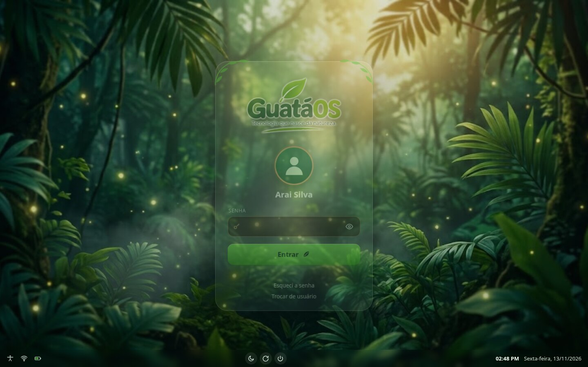
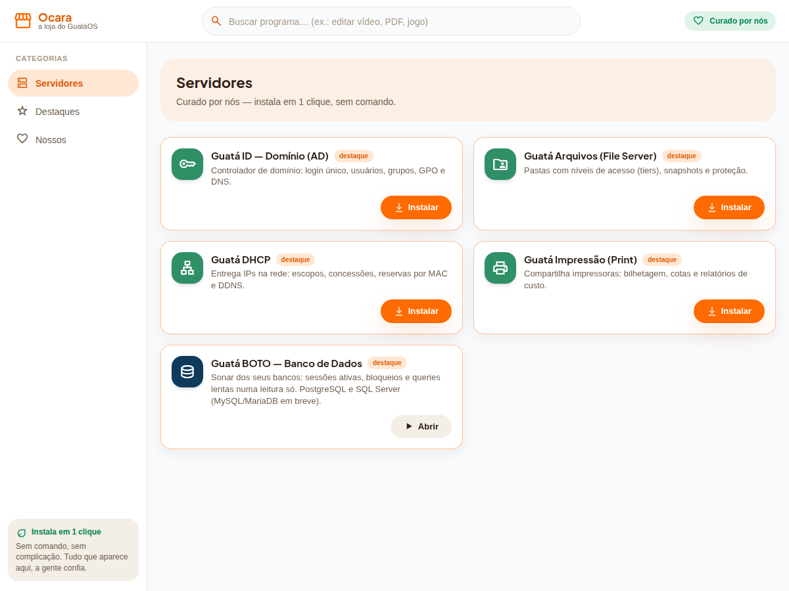
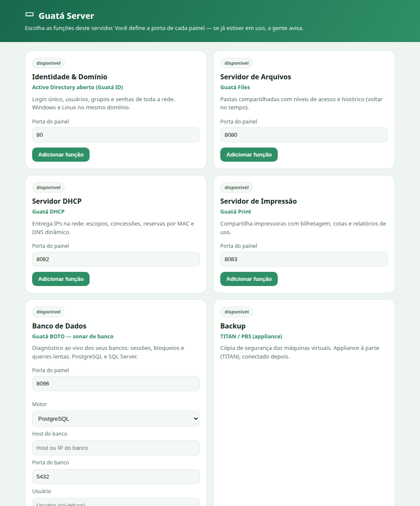

<p align="center">
  
</p>

<h1 align="center">GuataOS</h1>

<p align="center">
  <strong>A distribuição Linux brasileira — soberana, em português, com identidade própria.</strong><br>
  <em>A sovereign Brazilian Linux distribution — in Portuguese, with its own identity.</em>
</p>

<p align="center">
  <a href="https://guataos.com.br">guataos.com.br</a>
  &nbsp;·&nbsp; Debian 13
  &nbsp;·&nbsp; open source
  &nbsp;·&nbsp; <strong>BETA</strong>
</p>

---

## O que é

O **GuataOS** é um Linux brasileiro construído sobre o Debian, pensado para ser **simples, bonito e soberano** — do desktop ao servidor. Nasce de uma ideia direta: *a tecnologia deveria ser humana e ter a nossa cara.*

Inspirado na natureza e na biodiversidade do Brasil, reúne três coisas numa identidade só:

- **Um desktop limpo e nosso** — tela de entrada, papéis de parede dos biomas, sons e ícones com a mesma linguagem visual.
- **A Ocara** — uma loja de aplicativos que **instala em um clique**, com curadoria e sem complicação.
- **Um servidor que ganha funções** — como o Windows Server, só que aberto e em português: domínio (AD), arquivos, DHCP, impressão e banco de dados, cada um com um painel web guiado.

> **Não é só mais um tema de Linux.** É um sistema com identidade própria — e a jornada está só começando.

---

## Telas

<p align="center">
  
  <br><em>Ocara — a loja do GuataOS: instala em um clique, com curadoria.</em>
</p>

<p align="center">
  
  <br><em>Guatá Server — transforma o sistema em servidor escolhendo funções, pelo navegador.</em>
</p>

<p align="center">
  
  <br><em>Papéis de parede inspirados nos nossos biomas — Amazônia, Mata Atlântica, Cerrado, Pantanal, Caatinga, Pampa...</em>
</p>

---

## O servidor: funções (roles)

Cada função veste um motor open-source consagrado com um **painel web no mesmo padrão** e um assistente guiado. A tese: *um motor poderoso, vestido de fácil, lindo e soberano.*

| Função | Pacote | Motor por baixo | O que faz | Estado |
|---|---|---|---|---|
| **Guatá ID** (AD) | `guata-id` / `guata-ad` | Samba AD DC | Domínio: pessoas, grupos, máquinas, GPO, DNS, auditoria | BETA — no ar |
| **Guatá Files** | `guata-files` | Samba + VFS | Arquivos: compartilhamentos, níveis de acesso, snapshots anti-ransomware, ClamAV | BETA — no ar |
| **Guatá DHCP** | `guata-dhcp` | Kea / isc-dhcp | Entrega de IPs: escopos, leases, reservas por MAC, DDNS | BETA — no ar |
| **Guatá Print** | `guata-print` | CUPS | Impressão: bilhetagem, cotas por usuário, relatórios de custo | BETA — no ar |
| **Guatá Server** | `guata-server` | — | Menu "Adicionar função" (Debian e Oracle Linux 9) | BETA — no ar |
| **Guatá BOTO** | `guata-boto` | psql / sqlcmd | Sonar de banco de dados: sessões, bloqueios e queries lentas numa leitura só (PostgreSQL e SQL Server) | BETA — no ar |

---

## Como instalar as funções

**Debian / GuataOS:**
```bash
sudo apt install guata-server      # traz o menu de funções
sudo guata-server                  # "Adicionar função": AD / Arquivos / Banco (BOTO)...
```

**Oracle Linux 9 / RHEL** (repositório `el9`, painel web):
```bash
sudo dnf config-manager --add-repo https://guataos.com.br/el9/guata.repo
sudo dnf install guata-server
guata-server-token                 # mostra a URL do painel + o token de acesso
```

📘 **Documentação completa:** [guataos.com.br/docs](https://guataos.com.br/docs) — instalar, montar servidor, configurar AD/Files/DHCP/BOTO/Backup.

Cada função abre seu **configurador web** ao instalar. Tudo também aparece na loja **Ocara** — instalar uma função pela loja transforma o desktop em "Guatá Server".

---

## Mapa do repositório

```
GuataOS/
├── distro/          ← a distribuição (guataOS, baseada no Debian 13)
├── roles/           ← as funções de servidor (id, ad, files, dhcp, print, server, boto)
├── brand/           ← identidade visual: logos e mascotes
├── site-servidores/ ← página pública de servidores
└── docs/            ← doutrina, arquitetura, roadmap e termos
```

Este repositório é o **espelho público versionado + documentação** do ecossistema GuataOS.

---

## Doutrina em uma linha

**O Guatá não esconde, traduz.** Nada de botão cosmético, nunca inventar funcionalidade que não existe de verdade, interface limpa, segurança e LGPD por concepção. Detalhes em [docs/doutrina.md](docs/doutrina.md).

---

## Como ajudar

O GuataOS está em **desenvolvimento ativo (BETA)** e contribuições são bem-vindas:

- **Dê uma estrela** se gostou da ideia — ajuda o projeto a ser encontrado.
- **Abra uma issue** para relatar um problema ou sugerir algo.
- **Contribua** — veja [CONTRIBUTING.md](CONTRIBUTING.md) e o [ROADMAP.md](ROADMAP.md).

---

<p align="center">
  <strong>Feito no Brasil · Made in Brazil</strong><br>
  Inspirado na nossa natureza. A capivara Guatá é a nossa cara.
</p>

<p align="center">
  <sub>Software em <strong>BETA</strong> — veja os <a href="TERMOS.md">Termos de Uso e Isenção</a> e <a href="CHANGELOG.md">o que veio de novo</a>. Um produto Wellsystem.</sub>
</p>
